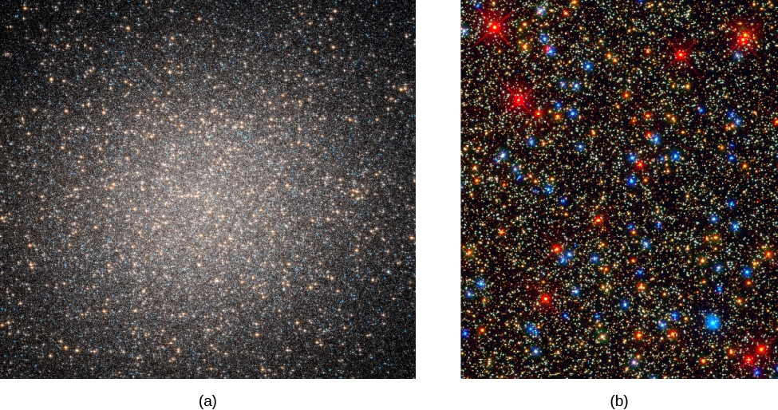
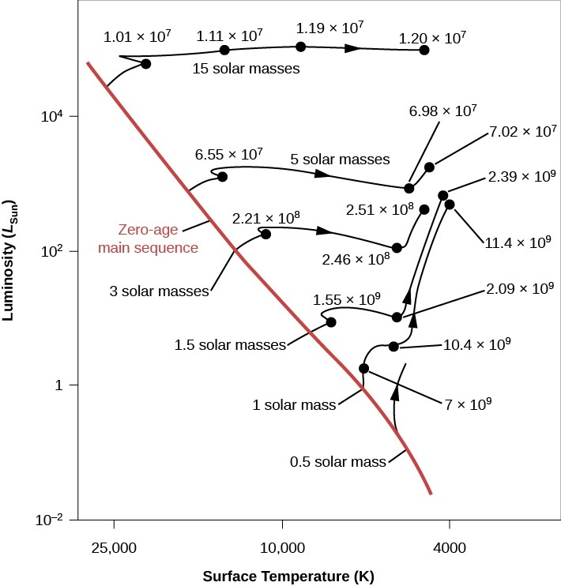
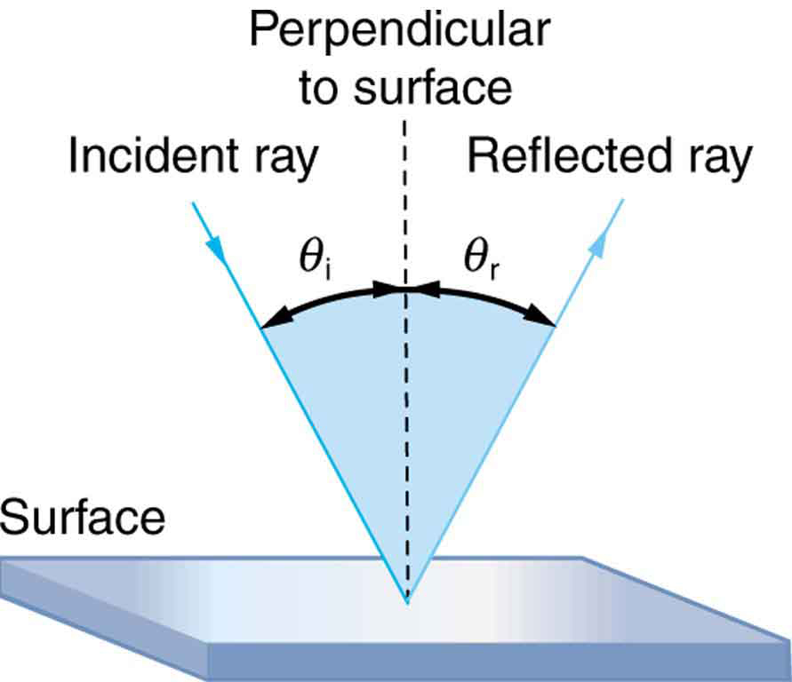
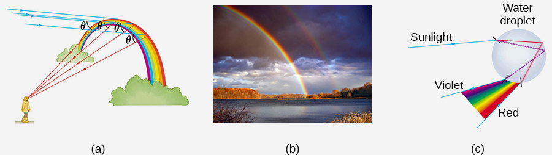
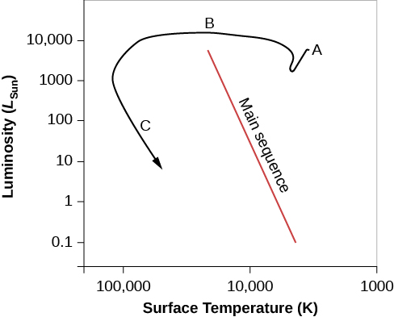
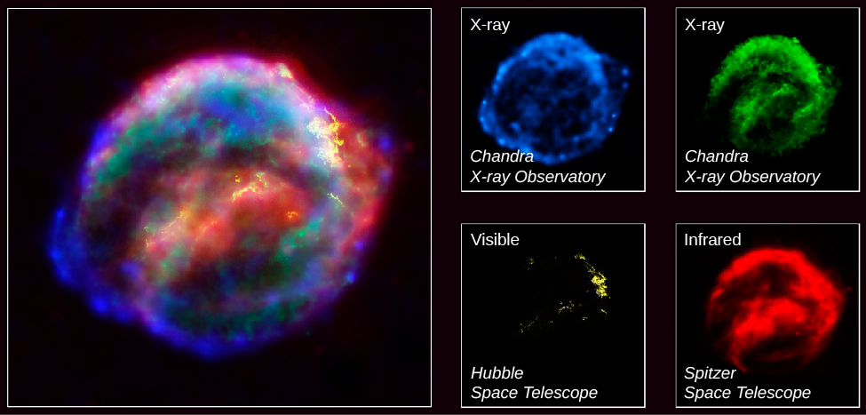

# Accessible Descriptions

## Definition of Accessible Description
Accessible description are as an addition to the image, so that all students can access the information in the figure. An accessible description is significantly longer than alt-text. 

## Format of Accessible Description
- The first line is the figure number and title.
- The second line is a brief description of the figure.
- The format of the rest of the description depends strongly on the type of image. In general, it should be broken up into separate sections using sub-headers. If the description is lengthy, break it into brief statements in a bulleted list, describing some components using nested bullets. Refer to examples below.
- If there is an image credit in the supporting text, include it as the last line of the description
  - Examples of credits in supportin text: (credit: Adam Evans) or (credit: modification of work by Hubble Legacy Archive, NASA, ESA, and Judy Schmidt).
  - Remove text similar to "modification of work by" Examples of edited text for accessible description: Credit: Adam Evans or Credit: Hubble Legacy Archive, NASA, ESA, and Judy Schmidt.
  - If there is something at the end of the figure caption that looks like this: (Openstax Astronomy), that is not an image credit, that is a signal to use the default Openstax Astronomy figure attribution. 
     - Do not turn (Openstax Astronomy) into an image credit.  
     - If there is an credit before it, then follow the instructions for moving the image credit. 
        - Example. If it looks like `(credit: ESO) (Openstax Astronomy)` Use `(credit: ESO)` to add a credit to the accessible description and do not use (Openstax Astronomy) in the accessible description

<!-- Follow any general guidelines in astro_figs.html, such as which words are appropriate for the textbook. -->

## Accessible Description Guidelines
Follow these guidelines when generating accesible descriptions.

### Accessible descriptions should answer four questions:

1. What is shown?
2. What relationships or patterns matter?
3. What labels or text must students know?
4. What is the instructional takeaway?

### What to include

- Title of the visual (if present)
- Scope (what area, system, or process is shown)
- Key parts, axes, or regions, or objects
    - For astronomical objects, includes the proper name or the type of astronomical object or objects and a physical description of the object or objects. e.g. The three bright stars in the belt of the constellation Orion.
- Relationships, trends, or sequences
- Labels that are instructionally important
- Conclusions students should draw
- Supporting text:
  - Always use any supporting text, if provided. Generate additional description if obvious components are missing.
  - The relevant supporting text may be in the html in the form of the original figure caption text, figure title, image credit, and original alt text.
  - If there is no supporting text, generate a description based on the image.

### Guidelines for Complex Figures
- If the figure has multiple subfigures:
  - If the individual figures are numbered or use letters to identify them, then refer to them in the caption by figure type and number or letter. Examples: Image (a), Chart 2.
  - If the individual figures have complex labels, refer to them by the figure type and label. Examples: the image labeled Orion nebula, the chart labeled H-R Diagram.
  - If the individual figures are not labeled or numbered any any way, then refer to the subfigures as panels and refer to them by location. 
     - If there is a single row, number them and refer to them from left to right. 
     - If there is a single column, refer to them as top, middle, and bottom. 
     - If there are multiple columns or rows, use a combination such as top right, center left, etc.  Start at the upper left and finish at the bottom right.

<!-- The H-R diagram is a standard chart used in astronomy. Always remember these characteristics. -->

### What to Avoid

- Exhaustive visual detail
- Stylistic descriptions
- Conclusions beyond what is in the figure - describe only what is actually present.

### Address Color and Visual Encoding

Color is almost always important in astronomy figures: If there is no explanation of the meaning of color, ask the content expert.

- Explicitly describe the meaning of color in text
- Always describe color in images
- For false color images, explain how the colors are assigned if available, or include the wavelength of the light. Example: An infrared image of the Crab nebula

When describing the instructional takeaway, use color when it is relevant. Otherwise, describe what the color represents. Examples:

- In this globular cluster, the blue stars are larger and bright than the yellow stars.
- There is more detail of the complex structure in the infrared image of the Crab Nebula compared to the visible image.

### Handle Images That Contain Text

If the image includes text students need to know, include verbatim in the accessible description

Examples:

- Chart titles, axis labels, data ranges
- Diagram labels
- Map legends

## HTML Format

<h2>Figure FigureNumber FigureTitle</h2>

Brief Description.

<h3>Subsection</h3>

<ul>
 <li>Description.</li>
 <li>Description</li>
 <li>Description</li>
 </ul>

<h3>Subsection</h3>

<ul>
 <li>Description</li>
 <li>Description</li>
 <li>Description</li>
 <li>Description </li>
 <ul>
 <li>Description</li>
 <li>Description</li>
 <li>Description</li>
 </li>
 </ul>

## Examples

Examples of accessible descriptions in HTML

### Example 1

 

Supporting Text:Two Images of the Globular Cluster Omega Centauri. Panel (a), on the left, shows a ground-based image of Omega Centauri as a large sphere of thousands of stars that is so dense that the central region appears as an indistinct patch of light. Panel (b), on the right, shows a high-resolution H S T image of the central region, showing dozens of bright red and blue stars amidst a background of thousands of fainter yellow stars.

<h2>Figure 12.2.1 Omega Centauri</h2>

Two Images of the Globular Cluster Omega Centauri.

<h3>Image (a)</h3>

<ul>
 <li>On the left</li>
 <li>Ground-based image of Omega Centauri as a large sphere of thousands of stars that is so dense that the central region appears as an indistinct patch of light.</li>
 <li>Credit: NASA, ESA and the Hubble Heritage Team (STScI/AURA)</li>
 </ul>

<h3>Image (b)</h3>

<ul>
 <li>On the right</li>
 <li>A high-resolution Hubble Space Telescope image of the central region, showing dozens of bright red and blue stars amidst a background of thousands of fainter yellow stars.</li>
 <li>Credit: NASA, ESA, and the Hubble SM4 ERO Team</li>
 </ul>

### Example 2

 

Supporting Text:

Evolutionary Tracks of Stars of Different Masses. In this plot the vertical axis is labeled “Luminosity (LSun)” and goes from 10-2 at the bottom to over 104 at the top. The horizontal axis is labeled “Surface Temperature (K)” and goes from 25,000 on the left to 4,000 on the right. The “Zero-age main sequence” is drawn as a diagonal red line beginning above L = 104 at the upper left of the image down to T ~ 4000 at the lower right. Six evolutionary tracks are drawn. Beginning at the top, a star of “15 solar masses” is plotted. It leaves the main sequence above L ~ 104 and T ~ 25,000. The track moves rightward across the top of the plot. The star maintains a relatively constant luminosity, but its surface temperature decreases with time. At “1.01 X107” years its temperature is about 20,000 K. At “1.11 X107” years it has fallen to about 15,000 K. At “1.19 X107” years T is about 9000 K, and the track ends at “1.2 X107” years near 4000 K. Next, a star of “5 solar masses” is plotted beginning near L ~ 103, where it leaves the main sequence. The star maintains a relatively constant luminosity, but its surface temperature decreases with time. At “6.55 X107” years its temperature is about 12,000 K. but its surface temperature decreases with time. At “2.39 X107” years it has fallen to about 5000 K. Then the luminosity rises slightly to the final plotted point at “7.02 X107” years near 4000 K. Next, a star of “3 solar masses” leaves the main sequence near L = 102 and 15,000 K. After “2.21 X108” years its temperature has fallen to near 11,000 K. After “2.46 X108” years its temperature has dropped to near 6000 K. Then, its luminosity increases by about a factor of ten where its curve ends at “2.51 X107” years and 5000 K. Next, a star of “1.5 solar masses” leaves the main sequence near L = 30 and 9000 K. After “1.55 X109” years its temperature has fallen to near 7500 K. After “2.09 X109” years, its temperature has dropped to near 5000 K. Then, its luminosity increases by about a factor of one hundred where its curve ends at “2.39 X109” years and 4000 K. Next, a star of “1 solar mass” leaves the main sequence at L = 1 and 5700 K. After “7 X109” years its temperature is nearly the same, but its luminosity has increased slightly. After “10.4 X109” years, its temperature has dropped to near 5000 K, and its luminosity has increased about 20 times. Then, its luminosity steadily increases to where its curve ends at “11.4 X109” years, L ~ 103 and T ~ 4000 K. Finally, a “0.5 solar mass” star is partially plotted. Its curve begins at L ~ 10-1 near T ~ 5000. Its curve is a short arrow pointing upward as its evolutionary timescale is too great for this diagram.

Description:

<h2>Figure 12.1.5 Stellar Mass and Evolution</h2>

AN H-R Diagram with model evolutionary tracks of stars with a range of masses.

<h3>Chart Elements</h3>

<ul>
 <li>The vertical axis is labeled Luminosity (LSun) and goes from 10-2 at the bottom to over 104 at the top with increments of 102.</li>
 <li>The horizontal axis is labeled Surface Temperature (K) and goes from 25,000 on the left to 4,000 on the right.</li>
 <li>The horizontal axis is non-linear. There are two increments of equal size, the first is from 25,000 to 10,000 and the second is from 10,000 to 4000.</li>
 <li>The Zero-age main sequence is drawn as a diagonal red line beginning above L = 104 at the upper left of the image down to T ~ 4000 at the lower right.</li>
 </ul>

<h3>Evolutionary Tracks</h3>

<ul>
 <li>Six total</li>
 <li>Beginning at the top</li>
 <li>All tracks have points marking the age of the star.</li>
 <li>15 solar masses
 <ul>
 <li>It leaves the main sequence above L ~ 3 x 104 and T ~ 25,000.</li>
 <li>The track moves mostly rightward across the top of the plot.</li>
 <li>Overall, the star maintains a relatively constant luminosity, but its surface temperature decreases with time.</li>
 <li>At 1.01 X107 years its temperature is about 20,000 K.</li>
 <li>As the track leaves the last point, it increases in temperature to just about 23,000 K and then makes a sharp turn to the right to meet the next point </li>
 <li>At 1.11 X107 years it has decreased in temperature and moved right on the chart to about 15,000 K.</li>
 <li>At 1.19 X107 years T is about 9000 K </li>
 <li>The track ends at 1.2 X107 years near 4000 K.</li>
 </ul>
 </li>
 <li>5 solar masses
 <ul>
 <li>Begins near L ~ 103, where it leaves the main sequence.</li>
 <li>Overall, the star maintains a relatively constant luminosity, and its surface temperature decreases with time.</li>
 <li>At 6.55 X107 years its temperature is about 15,000 K. The star's luminosity has increased to roughly 3 x 103.</li>
 <li>There is a very small increase in temperature after the last time point.</li>
 <li>At 6.98 x 107 years the surface temperature is about 5000 K.</li>
 <li>The track ends at 7.02 x 107 years at a temperature of about 4500 K. The luminosity has increased to roughly 4 x 103.</li>
 </ul>
 </li>
 <li>3 solar masses
 <ul>
 <li>Leaves the main sequence near L ~ 102</li>
 <li>Overall, the star is relatively constant luminosity until the end of last time point. The surface decreases the most during the first two sections of the track and then decreases a small amount at the end of the track. During the same section, the luminosity increases.</li>
 <li>At 2.21 X108 years its temperature is about 12,000 K. The star's luminosity has increased to roughly 2 x 102.</li>
 <li>There is a very small increase in temperature after the last time point.</li>
 <li>At 2.46 X 108 years the surface temperature is about 5500 K. The luminosity has decreased back to 102.</li>
 <li>The track ends at 2.51 X 108 years at a temperature of about 4500 K. The luminosity has increased to roughly 6 X 102.</li>
 </ul>
 </li>
 <li>1.5 solar masses
 <ul>
 <li>Leaves the main sequence near L ~ 10.</li>
 <li>Overall, the star decreases in temperature with time. At first the luminosity is mostly constant, but it increases by a large amount in the last section of the track.</li>
 <li>At 1.55 X 109 years its temperature is about 7000 K. The star's luminosity has increased to roughly 30.</li>
 <li>There is a very small increase in temperature after the last time point.</li>
 <li>At 2.09 X 109 years its temperature is about 6000 K. The star's luminosity stays near 30.</li>
 <li>At 2.39 X109 years it's temperatures has decreased to about 5000 K. Its luminosity increases to 3 x 102.</li>
 </ul>
 </li>
 <li>1 solar mass
 <ul>
 <li>Leaves the main sequence at L = 1 and 5700 K.</li>
 <li>After 7 X 109 years its temperature is nearly the same, but its luminosity has increased slightly.</li>
 <li>After 10.4 X 10 9 years, its temperature has dropped to near 5000 K, and its luminosity has increased to 10.</li>
 <li>Its luminosity steadily increases to where the curve ends at 11.4 X109 years, L ~ 103 and T ~ 4000 K.</li>
 </ul>
 </li>
 <li>0.5 solar mass
 <ul>
 <li>Begins at L ~ 10-1 near T ~ 5000.</li>
 <li>Its curve is a short arrow pointing upward as its evolutionary timescale is too large for this diagram.</li>
 </ul>
 </li>
 </ul>

### Example 3

 

Edited, rendered description

<h2>Figure 4.1.1 Reflection</h2>

A diagram illustrating the law of reflection.

<h3>Diagram Elements</h3>

<ul>
    <li>A flat, reflective surface is depicted as a shaded horizontal plane, labeled Surface, extending toward the bottom of the image.</li>
    <li>A dashed vertical line labeled Perpendicular to surface extends upward from a single point on the surface, marking the normal line used to measure the angles of the rays.</li>
    <li>An Incident ray, shown as a solid blue arrow, travels from the upper left down toward the point on the surface where the dashed perpendicular line meets it.</li>
    <li>A Reflected ray, shown as a solid light blue arrow, travels from that same point on the surface upward to the right.</li>
    <li>The incident ray and the perpendicular line form an angle labeled θi, marking the angle of incidence.</li>
    <li>The reflected ray and the perpendicular line form an angle labeled θr, marking the angle of reflection.</li>
    <li>A shaded triangular wedge, bounded by the incident ray, the reflected ray, and the surface, highlights the region between the two rays and the perpendicular line.</li>
    <li>Curved double-headed arrows mark both θi and θr, indicating that the two angles are shown as equal in size.</li>
</ul>

## Example 4

 

Edited, rendered description

<h2>Figure 4.1.3&nbsp;Rainbow Refraction</h2>

Three panels demonstrating how a rainbow forms.

<h3>Image (a)</h3>

<ul>
    <li>On the left</li>
    <li>A diagram showing an observer standing at the bottom, viewing a rainbow arc. Each end of the arc ends in a bush.</li>
    <li>Several parallel blue arrows enter from the upper left, representing incoming sunlight.</li>
    <li>Each incoming ray is redirected downward toward the observer's eye as a red ray.</li>
    <li>At each droplet, the angle between the incoming and outgoing rays is labeled θ.</li>
    <li>The rainbow itself is depicted as a multicolored arc, with red on the outer edge and blue/violet on the inner edge, spanning from the upper left to the bottom right bush.</li>
</ul>

<h3>Image (b)</h3>

<ul>
    <li>In the middle</li>
    <li>An image of a double rainbow arching over a landscape with a lake, trees, and distant hills under a partly cloudy sky.</li>
    <li>The brighter, primary rainbow is only a half arch, beginning in the upper right and curving toward the ground near the center of the image in the trees behind a lake.</li>
    <li>The fainter, secondary rainbow, also a half arch, is to the right of the primary rainbow.</li>
</ul>

<h3>Image (c)</h3>

<ul>
    <li>On the right</li>
    <li>A close-up diagram of a single spherical water droplet, tracing the path of a single ray of light through it.</li>
    <li>A blue arrow labeled Sunlight enters the droplet from the left.</li>
    <li>Inside the droplet, the ray is broken into two separate rays, one red and one violet.</li>
    <li>Both rays reflect off the back inner surface and exits toward the lower left.</li>
    <li>The red ray interacts with the back of the droplet a little higher than the violet droplet, and exits the bottom of the droplet a little to the right of the violet ray.</li>
    <li>As the two rays exit the droplet, they become a fan of rainbow colors.</li>
    <li>The emerging colors are labeled at each end, with Violet marking the left side of the fan, corresponding to where the violet ray exited the droplet. The right side of the fan is marked Red and corresponds to the red ray.</li>
</ul>

## Example 5

 

Edited, rendered description

<h2>Figure 13.1.3 Evolutionary Track for the Sun</h2>

An H-R Diagram showing the evolutionary track of the Sun plotted against the main sequence.

<h3>Chart Elements</h3>

<ul>
    <li>The vertical axis is labeled Luminosity (LSun) and goes from 0.1 at the bottom to 10,000 at the top, in increments of 10 times the previous value.</li>
    <li>The horizontal axis is labeled Surface Temperature (K) and goes from 100,000 on the left to 1,000 on the right, in increments of 10 times the previous value. The scale is logarithmic instead of linear.</li>
    <li>The straight red line is labeled Main sequence. It begins around 12,000 K and 6,000 LSun and ends near 6,000 K and 0.1 LSun.</li>
</ul>

<h3>Evolutionary Track</h3>

<ul>
    <li>The evolutionary curve is plotted in black.</li>
    <li>The overall behavior is that the track moves from the upper right of the chart, to the bottom left.</li>
    <li>It begins at point A, near 4,000 K and 6,000 LSun, to the right if the main sequence.</li>
    <li>Right after leaving point A, the track makes a small dip to lower luminosity and higher temperature, reverses course slightly.</li>
    <li>The track moves mostly horizontally, staying above the main sequence, passing through point B near 70,000 K and 10,000 LSun.</li>
    <li>The track then curves downward, reaching a maximum temperature of over 100,000 K, then ending at point C near 60,000 K and 10 LSun. The track continues to lose a small amount of luminosity and temperature and ends with an arrow.</li>
</ul>

<h2>Example 6</h2>

Edited, rendered description

<h2>Figure 13.2.3 Kepler Supernova Remnant</h2>

A multi-wavelength composite image of the Kepler Supernova Remnant, shown alongside its four individual wavelength components.

<h3>Combined Image</h3>

<ul>
    <li>The large panel on the left is the final combined image of the supernova remnant, a diffuse, spherical shell of gas an a black brackground.</li>
    <li>The shell is depicted in a mix of blue, green, red, and yellow, with bright regions near the center and the upper right.</li>
</ul>

<h3>Individual Wavelength Panels</h3>

<ul>
    <li>Four smaller panels are arranged to the right of the combined image, in a 2x2 grid. Each ones is a single color on a black background.</li>
    <li>Top left:
    <ul>
        <li>X-ray, shown in blue.</li>
        <li>Acquired by the Chandra X-ray Observatory.</li>
        <li>The structure and brightness is relatively consistent througout the circular shape, with bright spots around the outisde rings, and dark blotches near the center.</li>
    </ul>
    </li>
    <li>Top right:
    <ul>
        <li>X-ray, shown in green.</li>
        <li>Acquired by the Chandra X-ray Observatory.</li>
        <li>The overall structure is similar to a swirl, starting on the left side, extending clockwise, and ending in the center.</li>
        <li>The detail in the fine structure of the gas is improved compared to the top left image.</li>
    </ul>
    </li>
    <li>Bottom left:
    <ul>
        <li>Visible, shown in yellow.</li>
        <li>Acquired by the Hubble Space Telescope.</li>
        <li>There are just a few wisps of cloud, mostly on the upper right, with small points near the center.</li>
    </ul>
    </li>
    <li>Bottom right:
    <ul>
        <li>Infrared, shown in red.</li>
        <li>Acquired by the Spitzer Space Telescope.</li>
        <li>The shape is similar to the top right image, except with less detail.</li>
    </ul>
    </li>
</ul>

Credit: modification of work by NASA, ESA, R. Sankrit and W. Blair (Johns Hopkins University)

