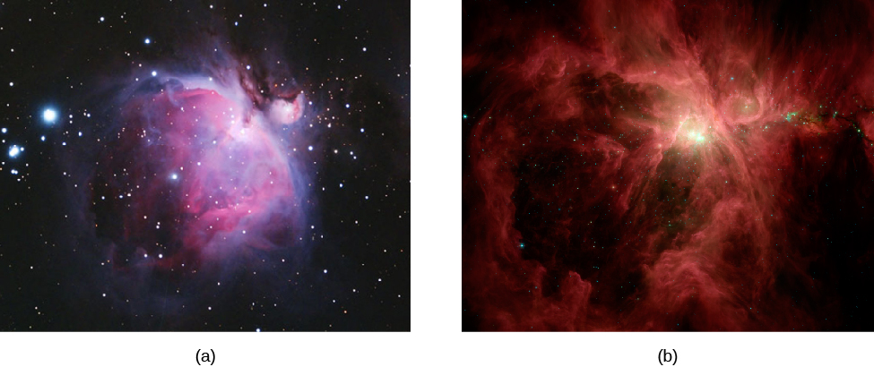
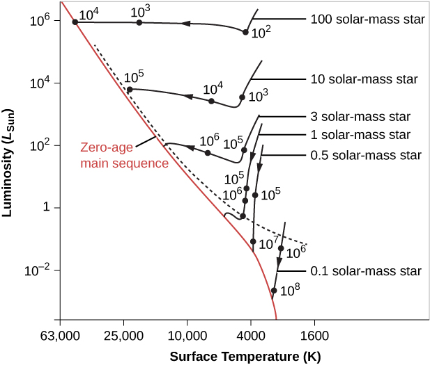
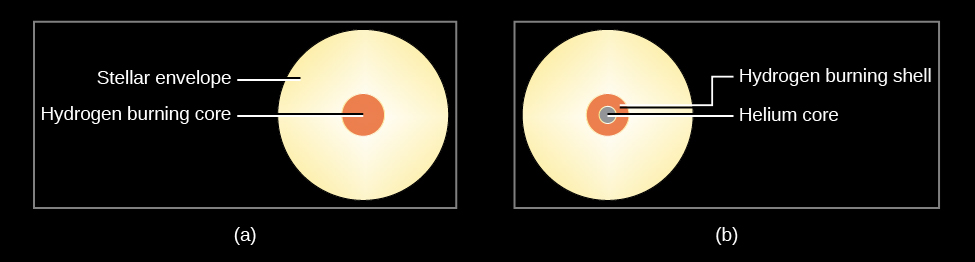

# Alternative Text

Alternative text, or alt-text is a very brief description of a figure that is included in the html for the figure. Alternative text can be read by screen readers, and uses as identifying information embedded in the figure.

## Alternative Text Guidelines
- The text should be 125 characters or less to prevent overloading screen readers.
- The text should reflect what a sighted student gains from the image.
- The text should identify the relevant object(s)
- Use caution when identifying the type of figure.
  - If it is an image, do not call it an image or photo because it is redundant. Example, if it is an image of a sunset, the alt-text should be: Sunset by a lake with mountains.
  - For other types, such as diagrams, or maps, the type of figure can be described. Example: Topographic map of Olympus Mons.
  - For charts, prioritize the content of the chart over naming the figure as a chart.
- Use the figure, and supporting text, original figure caption and original alt-text, as a basis for generating the alt-text.
- If there is no figure caption and/or alt-text just use the figure.
- If there are multiple parts of the figure, enumerate or describe the difference. Examples: Four type Ia supernova. Orion nebula in visible and infrared light.
- Minimize the use of articles, especially at the beginning. e.g. Orion Nebula instead of The Orion Nebula
- Although it ends with a period (.), alt-text does not need to be a complete sentence.
- `Details in caption.` is included in the default format for the figure html, so the statment should not be included when creating new alt-text.

# Examples

Examples of alternative text in HTML for figures in an OER astronomy textbook.

## Example 1

 

alt-text: Orion Nebula in visible and infrared.

## Example 2

 

alt-text: Hertzsprung-Russell diagram with protostars of different mass.

## Example 3

 

alt-text: Hertzsprung-Russell diagram with protostars of different mass.
