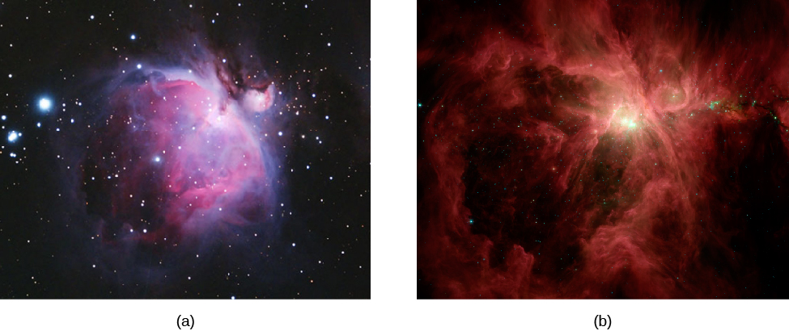
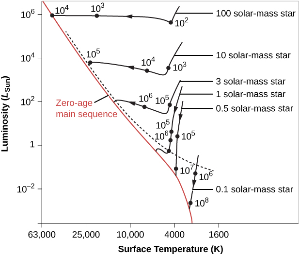
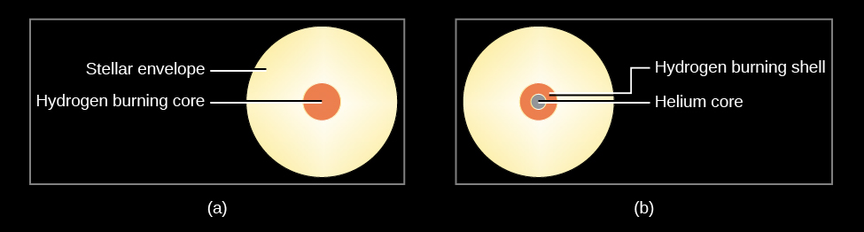

# Style for Caption Text

## Figure Caption Text

Each figure requires new caption text. Create the text following these guidelines in the given HTML format. Some examples are given below.

## Figure Caption Text Guidelines
When generating caption text, Claude should follow these guidelines:
- The caption text is a part of the overall figure caption, located between the title and the figure attribution.
- The caption text should focus on the main learning objective of the figure.
- Use the original alt-text and original caption text from the submitted figure and the figure itself to create the new caption text.
- Do not replicate the alt-text verbatim in the caption. Some words may be the same, but the caption text should have more details regarding the learning objective.
- The caption text should be brief, one or two complete sentences.
- If the figure is an image, include the name of the telescope or spacecraft and the wavelength of light, e.g. observed, visible, X-ray, inrared, if available.
- If the figure has multiple subfigures: refer to them based on their type and labels. e.g. Image (a), Diagram (c)

# Examples

Examples of figure caption text for figures in an OER astronomy textbook.

## Example 1

 

Figure caption text: The visible light in Image (a) of the Orion nebula reveals its structure, but infrared light in Image (b) can reveal significantly more details.

## Example 2

 

Figure caption text: The tracks traced on the H‐R diagram by developing protostars demonstrate how the length of time they take to form decreases with mass.

## Example 3

 

Figure caption text: During the main sequence, in Diagram (a), a star has a core where hydrogen is fusing and a much larger envelope that is too cold for fusion. In Diagram (b), The hydrogen in the core is replaced with helium and hydrogen begins fusing in a shell around the helium. Core not drawn to scale..
